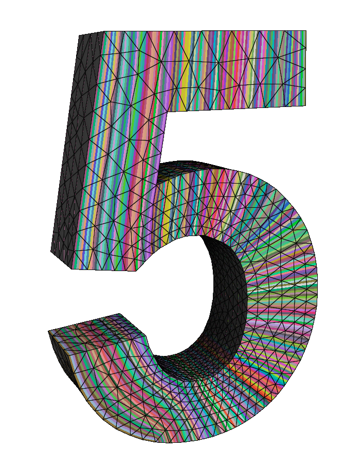
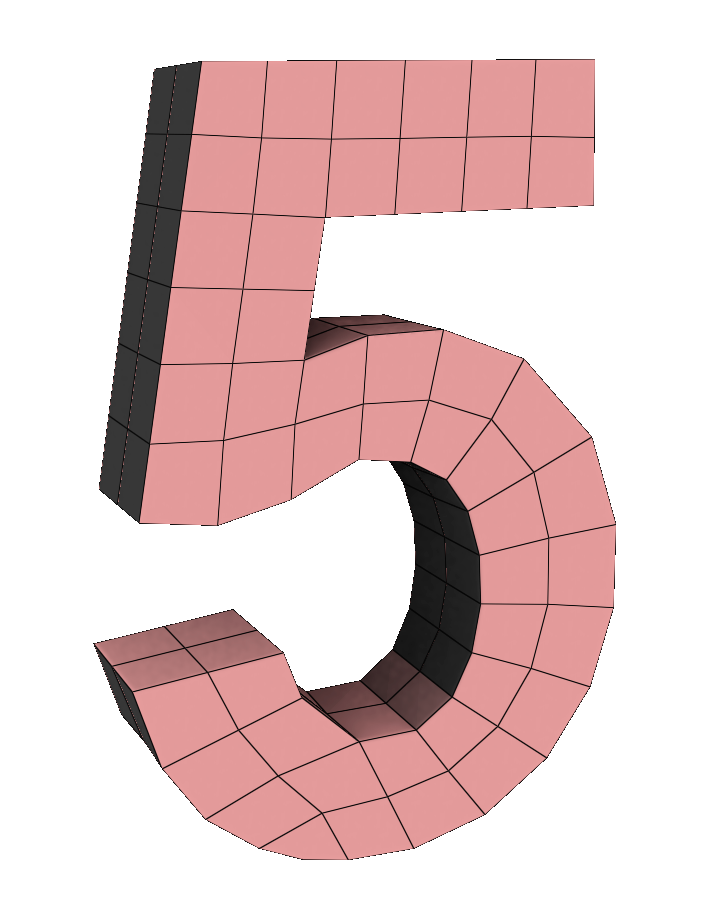

libHexEx – A Robust Hexahedral Mesh Extractor
======

| Input (tet) | Output (hex) | Output (complex) |
| :---: | :---: | :---: |
|  |  |  |

## Changes compared to the original libHexEx

This is a fork of the original `libHexEx`: the extraction algorithm itself is untouched,
but the build system and the API surface around it were reworked, and the **embedded cell
complex that records where every extracted element comes from is now exposed**.

### Dependency and build refactoring

* **Dependencies are git submodules** instead of something you have to install by hand:
  * `third_party/OpenVolumeMesh` — [OpenVolumeMesh](https://gitlab.vci.rwth-aachen.de:9000/OpenVolumeMesh/OpenVolumeMesh),
    pinned to the tag `v3.4.1`. No separate OpenVolumeMesh installation is needed any more.
  * `third_party/googletest` — [GoogleTest](https://github.com/google/googletest) v1.17.0,
    used by the unit tests only.
  * `third_party/CLI11` — [CLI11](https://github.com/CLIUtils/CLI11) v2.7.2, used by the
    `hexex` application.
  * `geogram` stays optional and is detected automatically (`~/geogram`, or an installed
    copy); `-DGEOGRAM_ROOT=<path>` points at a geogram source tree,
    `-DHEXEX_WITH_GEOGRAM=OFF` disables the bridge.
  * When the submodules are not initialized, CMake falls back to downloading the same
    versions via FetchContent, so a plain non-recursive clone still configures.
* **CMake refactoring**: C++17, target based linking and usage requirements, config aware
  output directories — every executable ends up in `<build>/bin`, every library in
  `<build>/lib` (there is no extra `<build>/Build` directory any more), and the unit test
  binary is `<build>/bin/unittests`.
* **New build targets**: the `HexExGeogram` bridge library, the `hexex` application
  (`apps/hexex`) and the `export_trajectory` demo, next to the pre-existing `cmdline_tool`
  and `minimum_example`.
* The extractor's progress/debug output is now a runtime switch (`HexEx::setVerbose()`)
  instead of a compile-time one, so the command line application can run quietly.

### Embedded cell complex / trajectory support (new)

While extracting, HexEx traces grid edges (darts) through the input tetrahedra. Those
traces are now recorded, which makes the *where does every extracted element come from*
available as a genuine **embedded cell complex** — the input tetrahedral mesh cut along
all integer grid planes into vertices, edges, facets and tetrahedra — together with

* the **polyline of every hex edge** (the chain of pieces it passes through),
* the **patch of every hex face** and the **pieces of every hex cell**,
* the **correspondence** between the hex mesh elements and the elements of the complex,
* per vertex / edge / facet / cell labels stating where each element comes from (the input
  tet vertex / edge / face / cell it lies on).

API: `HexEx::HexTrajectoryLayout` plus `HexEx::HexExtractor::getHexMeshWithTrajectory()`.
Writers: `demo/export_trajectory` (writes both meshes and verifies them by reading them
back) and the `HexEx::GeogramBridge` (`toRefinedMesh()`, `toHexMesh()`, `save()`), which
stores *all* of the above in `GEO::Mesh` **attributes** (`kind`, `tet_vertex`, `tet_edge`,
`tet_face`, `tet_cell`, `hex_vertex`, `hex_edge`, `hex_edge_step`, `hex_face`, `hex_cell`,
`grid`, `grid_axis`, `piece`, `border`, `n_refined`, `n_pieces`), so exporting to `.geogram` loses
nothing. Attributes that can be "not there" are `int` (holding -1), all others are
`unsigned int`.

The correspondence does not use a global integer grid frame: such a frame does not exist
for a general integer-grid map, because the frame rotates around the singular edges of the
parametrization. Instead, the pieces of every unit cube are grouped by propagating the
extractor's transition functions, which are exact per face.

Measurements and the verification protocol are documented in
[`PROGRESS_trajectory_export.md`](PROGRESS_trajectory_export.md).

### Building

```bash
git clone --recurse-submodules <this repository>
cmake -S . -B build
cmake --build build
```

(Without `--recurse-submodules`: `git submodule update --init --recursive`.)

Optional dependency selection:

```bash
cmake -S . -B build -DGEOGRAM_ROOT=~/geogram   # where to find geogram
cmake -S . -B build -DHEXEX_WITH_GEOGRAM=OFF   # build without the geogram bridge
```

Executables go to `build/bin`, libraries to `build/lib`.

### Using the `hexex` command line application

`hexex` replaces the former `demo/cmdline_tool` (and can do what the `export_trajectory`
demo does, except for the read-back verification):

```bash
build/bin/hexex --in <input.hexex> --out <hex.ovm|hex.geogram> [--out-complex <complex.geogram>]
```

The format of `--out` is chosen from the file name: `.ovm` is written with OpenVolumeMesh,
every other extension with geogram (`.geogram`, `.mesh`, ...; only `.geogram` keeps the
cells and the trajectory attributes). `--out` and `--out-complex` also accept a directory,
in which case the file names are derived from the input mesh (`<input>_hex.ovm`,
`<input>_complex.geogram`). `--out-complex` writes the embedded cell complex described
above (the trajectories of the extracted elements) as a geogram mesh (with all attributes).
Run `build/bin/hexex --help` for the details.

---

`libHexEx` is an implementation of [HexEx](https://www.graphics.rwth-aachen.de/publication/03260/) \[[Lyon et al. 2016](http://dx.doi.org/10.1145/2897824.2925976)\] distributed under GPLv3.

If you make use of `libHexEx` in your scientific work, please cite our paper. For your convenience,
you can use the following bibtex snippet:

    @article{Lyon:2016:HRH:2897824.2925976,
     author = {Lyon, Max and Bommes, David and Kobbelt, Leif},
     title = {{H}ex{E}x: Robust Hexahedral Mesh Extraction},
     journal = {ACM Trans. Graph.},
     year = {2016},
     numpages = {11},
     url = {http://dx.doi.org/10.1145/2897824.2925976},
     doi = {10.1145/2897824.2925976},
     acmid = {2925976},
     publisher = {ACM},
     address = {New York, NY, USA},
     keywords = {hex meshing, parametrization, mesh extraction},
    }

## What is HexEx?

HexEx is a method for robust hex mesh extraction from 3D Integer-Grid Maps with imperfections.
(Imperfect) 3D Integer-Grid Maps are what is generated by most state-of-the-art hex meshing
methods such as CubeCover \[[Nieser et al. 2011](http://dx.doi.org/10.1111/j.1467-8659.2011.02014.x)\].

Hex extraction is a complicated task because numerous special cases, ambiguities induced
by numerical inaccuracies and limited solver precision, as well as imperfections in the
maps pose significant challenges to the hex mesh extractor.

Read [our paper](https://www.graphics.rwth-aachen.de/publication/03260/) if you want
to find out why hex extraction is complicated and how we tackle it or skip ahead and
download the source code if you don't care about the details and just need results.

## License

`libHexEx` is free software: you can redistribute it and/or modify it under
the terms of the GNU General Public License as published by the Free
Software Foundation, either version 3 of the License, or (at your
option) any later version. See [http://www.gnu.org/licenses/](http://www.gnu.org/licenses/).

If you make use of `libHexEx` in scientific work we kindly ask you to cite our
paper. (You can use the bibtex snippet above.)

## Bibliography

[Lyon, M., Bommes, D. and Kobbelt, L. 2016. HexEx: Robust Hexahedral Mesh Extraction. ACM Trans. Graph.](http://dx.doi.org/10.1145/2897824.2925976)

[Nieser, M., Reitebuch, U. and Polthier, K. 2011. CubeCover - Parameterization of 3D Volumes. The Eurographics Association and Blackwell Publishing Ltd.](http://dx.doi.org/10.1111/j.1467-8659.2011.02014.x)
